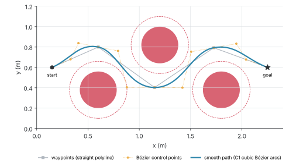
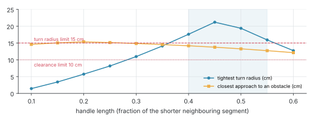
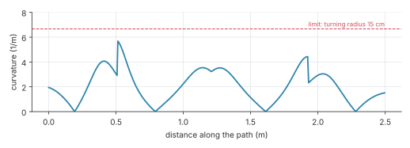
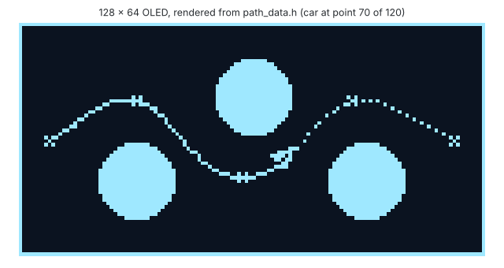

# Bézier Path Planning

[](https://github.com/HannaBeshoy/bezier-path-planning/actions/workflows/ci.yml)

**Computer Graphics course project** (credited from *Computer Aided Mathematics and Visualization*) · University of Debrecen, Faculty of Informatics · MATLAB (also runs in GNU Octave), Arduino · **verified in simulation; OLED test planned for the December lab day**

A small robot car has to cross a room past three obstacles. Straight lines between corner points are short, but the car cannot turn on the spot at a corner. This project turns the corner points into a smooth path made of cubic Hermite and Bézier arcs, the curves of the course, checks that the car can really drive it (distance from the obstacles, tightest turn), and draws the result on a 128 × 64 OLED driven by an Arduino.

- [x] Hermite arcs (through points, or from points and tangent vectors) and Bézier curves (Bernstein form and de Casteljau), without the Symbolic Toolbox
- [x] Waypoints around circular obstacles, joined into a C1-continuous chain of cubic Bézier arcs
- [x] Arc length, curvature, clearance; handle length chosen as the shortest path the car can drive
- [x] The curve exercises of the course practice sheet solved and tested
- [x] **15 self-checking tests pass**, in Octave on every push (GitHub Actions)
- [x] Arduino sketch that draws the path and drives a car icon along it on an SSD1306 OLED; Wokwi files for a browser simulation
- [ ] Lab day: the sketch on a real Arduino and OLED ([test sheet](docs/LAB_DAY.md))



## Result

| | Straight polyline | Smooth path (chosen) |
| --- | ---: | ---: |
| length | 2.425 m | 2.496 m (+2.9 %) |
| closest approach to an obstacle | 10 cm (by construction) | 14.2 cm |
| tightest turn the car must make | radius 0 at every corner | radius 17.6 cm |
| continuity | position only (C0) | position and tangent (C1) |

The smooth path costs 7 cm of extra distance, and in exchange the car never has to stop and turn: its tightest turn has a 17.6 cm radius, inside the 15 cm limit of the car.

## How the path is built

1. **Waypoints.** Start with the straight line from start to goal. Wherever a segment comes closer to an obstacle than its radius plus a 10 cm margin (half the car's width plus a safety gap), insert a corner point beside the obstacle, on the side the segment already leans to, and repeat. If that side is outside the room, go round the other side.
2. **Tangents.** At each inner waypoint the tangent points from the previous waypoint to the next one; its length is a "handle length" times the shorter neighbouring segment.
3. **Arcs.** Between neighbouring waypoints, the Hermite arc with those two points and two tangents. In Bézier form its control points are P0, P0 + V0/3, P1 − V1/3, P1. Neighbouring arcs share the point and the tangent vector, so the path is C1 continuous (checked at every joint: mismatch 0).
4. **Checks.** Sample the path, compute its length, its curvature κ = |x′y″ − y′x″| / (x′² + y′²)^(3/2) and its distance to every obstacle.
5. **Handle length.** Short handles hug the corners and turn sharply; long ones bulge out toward the obstacles and overshoot. The sweep below keeps the handle lengths that satisfy both limits (shaded) and picks the shortest path among them (0.40).





## On the OLED

`run_all.m` resamples the path into 120 points evenly spaced along its length, converts metres to pixels, and writes `arduino/oled_path/path_data.h` with the points, the heading at each point (the direction of the tangent vector) and the obstacles. The sketch draws the room and drives a triangle along the path at constant speed. The image below is the sketch's drawing re-done pixel by pixel by `docs/figures.py`; the `wokwi/` files run the real sketch in the browser at [wokwi.com](https://wokwi.com).



## Course exercises

`matlab/practice_exercises.m` solves the curve tasks of the course practice sheet (2024, sheet 2) numerically, each checked by a test:

| Task | Result |
| --- | --- |
| 6. degree-4 curve through 5 points at t = 0…4, tangent at t = 0.5 | point (12.89, 31.33), tangent (10.42, 21.25) |
| 7. Hermite arc through 4 points at t = −1, 0, 2, 3, tangent at t = 2 | (1.67, 1.00) |
| 8. three points at t = 0, 1, 1.5 and tangent (6, −4) at t = 0 | x(t) = −1.33t³ + 3.33t² + 6t − 2, y(t) = 0.89t³ + 3.11t² − 4t − 2 |
| 9. two points, two tangents | Bézier control points (−2, −2), (0, −3.33), (4.67, −3.33), (6, −2) |
| 10. Bézier curve with 5 control points, end tangents | (40, 80) at the start, (−120, −40) at the end |

The lecture scripts use `syms` and `solve`; here every condition is a row of a small linear system solved with `\`, which needs no toolbox and runs in Octave.

## Running it

MATLAB (no toolboxes):

```matlab
run_all                      % plan the path, write results/ and the Arduino header
run('tests/run_tests.m')     % 15 self-checking tests
practice_exercises(true);    % the course tasks, with figures
```

GNU Octave: `octave-cli run_all.m` and `octave-cli --eval "run('tests/run_tests.m')"`. Figures: `python3 docs/figures.py` (numpy, matplotlib).

**Arduino:** wire the OLED (VCC → 5V, GND → GND, SDA → A4, SCL → A5), install "Adafruit SSD1306" and "Adafruit GFX Library" from the Library Manager, open `arduino/oled_path/oled_path.ino` and upload.

## Repository layout

```text
run_all.m        the scene, the planner, the exports
matlab/          curves (Hermite, Bezier, de Casteljau), waypoints, smoothing, checks, course exercises
tests/           self-checking tests (helpers/ holds one function per test)
arduino/         the OLED sketch and its generated path_data.h
wokwi/           diagram.json and libraries.txt for a browser simulation
results/         path, scene, curvature and sweep tables of the last run
docs/            project guide, lab-day test sheet, figure script
```

See the [project guide](docs/PROJECT_GUIDE.md) for the mathematics step by step.

## Author

Beshoy Hanna · Computer Science Engineering BSc, University of Debrecen · [LinkedIn](https://www.linkedin.com/in/beshoy-hanna-8b52213a0)
